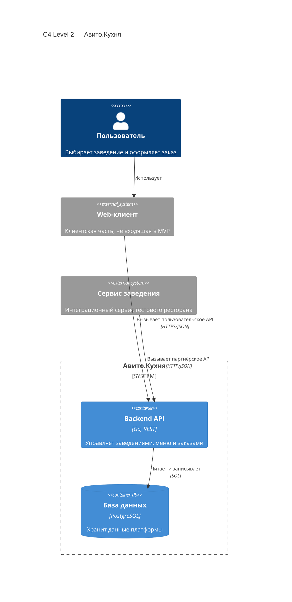

# Архитектура проекта «Авито.Кухня»

## Архитектурный подход

Для описания архитектуры используется C4-диаграмма уровня Container
(Level 2).

На этом уровне показаны отдельно запускаемые приложения, хранилища данных
и связи между ними. Под контейнером в C4 понимается не только
Docker-контейнер, а самостоятельное приложение или хранилище.

В MVP входят основной Backend API, PostgreSQL и демонстрационный сервис
заведения. Web-клиент отображается на схеме, но его реализация не входит
в тестовое задание.

## C4 Container Diagram

Диаграмма показывает основные приложения и хранилища системы,
а также взаимодействие между ними.

## Компоненты системы

### Web-клиент

Будущая клиентская часть, через которую пользователь сможет:

- просматривать список заведений;
- открывать меню;
- создавать заказы;
- получать информацию о заказах;
- отслеживать их статусы.

Web-клиент не реализуется в рамках MVP и показан как внешняя система.

### Backend API

Основной сервис платформы, реализованный на Go.

Backend API предоставляет:

- пользовательское REST API для работы с заведениями, меню и заказами;
- партнёрское REST API для интеграции с заведениями.

Сервис отвечает за:

- проверку входных данных;
- выполнение бизнес-правил;
- расчёт стоимости заказа;
- сохранение заказа;
- проверку допустимости переходов между статусами;
- взаимодействие с PostgreSQL.

### База данных

PostgreSQL является основным хранилищем данных платформы.

В базе данных хранятся:

- заведения;
- позиции меню;
- доступность и стоимость блюд;
- заказы;
- состав заказов;
- актуальные статусы заказов;
- данные для защиты от повторного создания заказа.

Доступ к PostgreSQL имеет только основной Backend API.

### Сервис заведения

Отдельный сервис, который имитирует информационную систему ресторана.

Сервис заведения:

- передаёт и обновляет своё меню;
- изменяет доступность блюд;
- запрашивает новые заказы;
- принимает или отклоняет заказы;
- обновляет статусы принятых заказов.

Сервис заведения не имеет прямого доступа к PostgreSQL и взаимодействует
с платформой только через партнёрское REST API.

## Владение данными

Основной сервис «Авито.Кухня» является источником актуальных данных
о заведениях, меню и заказах.

Сервис заведения хранит только собственную конфигурацию и использует
партнёрское API для синхронизации данных с платформой.

Web-клиент и сервис заведения не обращаются к базе данных напрямую.

## Пользовательское взаимодействие

1. Пользователь работает с web-клиентом.
2. Web-клиент обращается к пользовательскому API.
3. Backend API проверяет запрос и выполняет бизнес-логику.
4. Backend API читает или изменяет данные в PostgreSQL.
5. Результат возвращается web-клиенту.

В рамках MVP запросы пользовательского API можно выполнять через Swagger,
Postman или другой HTTP-клиент.

## Взаимодействие с заведением

Для получения заказов используется pull-модель:

1. Пользователь создаёт заказ через основной Backend API.
2. Backend API сохраняет заказ в PostgreSQL со статусом `created`.
3. Сервис заведения периодически запрашивает новые заказы.
4. Заведение принимает или отклоняет полученный заказ.
5. Сервис заведения отправляет новый статус через партнёрское API.
6. Backend API проверяет переход статуса и сохраняет изменение.

Такая модель позволяет сохранить пользовательский заказ, даже если сервис
заведения временно недоступен.

Недостатком является задержка между созданием заказа и его получением
заведением. Для MVP эта задержка считается допустимой.

## Архитектурные ограничения MVP

- Web-клиент не реализуется.
- Авторизация и аутентификация пользователей не реализуются.
- Сервис заведения не получает прямой доступ к PostgreSQL.
- Основной Backend API является единственной точкой работы с данными платформы.
- Один заказ может относиться только к одному заведению.
- Оплата, доставка и управление курьерами не входят в систему.
- Кэш и брокер сообщений не используются до появления обоснованных требований
  по нагрузке и асинхронному взаимодействию.