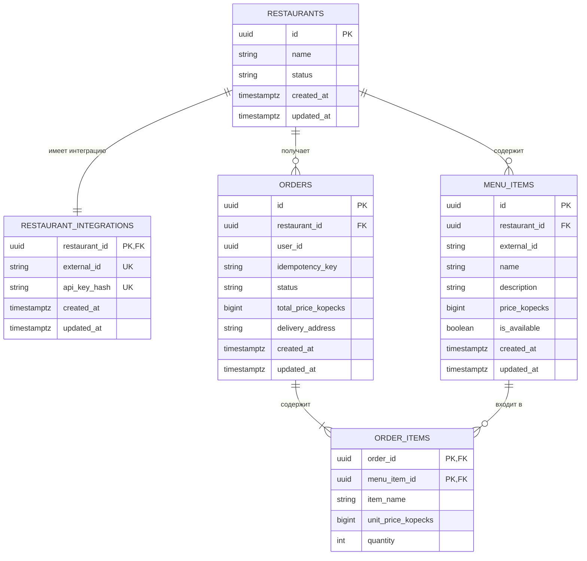

# Модель данных проекта «Авито.Кухня»

## Назначение

PostgreSQL является основным хранилищем данных платформы.

Модель данных должна поддерживать:

- хранение заведений;
- интеграцию с внешними системами заведений;
- хранение и обновление меню;
- создание пользовательских заказов;
- сохранение состава и стоимости заказов;
- обработку заказов заведениями;
- защиту от повторного создания одного заказа.

## ER-диаграмма



## Таблица `restaurants`

Содержит заведения, подключённые к платформе.

| Поле | Тип | Описание |
|---|---|---|
| `id` | `UUID` | Внутренний идентификатор заведения |
| `name` | `VARCHAR` | Название заведения |
| `status` | `VARCHAR` | Текущий статус заведения |
| `created_at` | `TIMESTAMPTZ` | Время создания записи |
| `updated_at` | `TIMESTAMPTZ` | Время последнего изменения |

Допустимые статусы:

- `active` — заведение доступно пользователям;
- `inactive` — заведение временно недоступно.

Пользователь может просматривать меню и создавать заказы только для
активного заведения.

## Таблица `restaurant_integrations`

Хранит данные, необходимые для связи заведения с его внешней системой.

| Поле | Тип | Описание |
|---|---|---|
| `restaurant_id` | `UUID` | Ссылка на заведение |
| `external_id` | `VARCHAR` | Идентификатор заведения во внешней системе |
| `api_key_hash` | `VARCHAR` | Хеш партнёрского API-ключа |
| `created_at` | `TIMESTAMPTZ` | Время создания интеграции |
| `updated_at` | `TIMESTAMPTZ` | Время последнего изменения |

`restaurant_id` одновременно является первичным и внешним ключом.
Это обеспечивает связь один к одному между заведением и его интеграцией.

`external_id` позволяет сопоставить внутренний идентификатор
«Авито.Кухни» с идентификатором заведения в партнёрской системе.

`api_key_hash` содержит SHA-256-хеш партнёрского ключа в hex-формате
длиной 64 символа. API-ключ в открытом виде в базе данных не хранится.

## Таблица `menu_items`

Содержит позиции меню заведений.

| Поле | Тип | Описание |
|---|---|---|
| `id` | `UUID` | Внутренний идентификатор блюда |
| `restaurant_id` | `UUID` | Заведение, которому принадлежит блюдо |
| `external_id` | `VARCHAR` | Идентификатор блюда в системе заведения |
| `name` | `VARCHAR` | Название блюда |
| `description` | `TEXT` | Описание блюда |
| `price_kopecks` | `BIGINT` | Стоимость в копейках |
| `is_available` | `BOOLEAN` | Доступность для заказа |
| `created_at` | `TIMESTAMPTZ` | Время создания записи |
| `updated_at` | `TIMESTAMPTZ` | Время последнего изменения |

Пара значений `(restaurant_id, external_id)` должна быть уникальной.
Одинаковые внешние идентификаторы могут использоваться разными заведениями.

Стоимость должна быть больше нуля.

Позиции меню не удаляются при временном отсутствии. Вместо удаления поле
`is_available` переводится в значение `false`.

## Таблица `orders`

Содержит пользовательские заказы.

| Поле | Тип | Описание |
|---|---|---|
| `id` | `UUID` | Идентификатор заказа |
| `restaurant_id` | `UUID` | Заведение, которое должно выполнить заказ |
| `user_id` | `UUID` | Идентификатор пользователя основной платформы |
| `idempotency_key` | `VARCHAR` | Ключ защиты от повторного создания заказа |
| `status` | `VARCHAR` | Текущий статус заказа |
| `total_price_kopecks` | `BIGINT` | Итоговая стоимость в копейках |
| `delivery_address` | `TEXT` | Адрес доставки |
| `created_at` | `TIMESTAMPTZ` | Время создания заказа |
| `updated_at` | `TIMESTAMPTZ` | Время последнего изменения |

Отдельная таблица пользователей не создаётся. `user_id` рассматривается
как идентификатор пользователя основной платформы Авито.

В MVP аутентификация не реализуется, поэтому идентификатор пользователя
передаётся клиентом. Способ передачи будет зафиксирован в OpenAPI.

Пара `(user_id, idempotency_key)` должна быть уникальной. Если клиент
повторно отправит запрос с тем же ключом, новый заказ создаваться не должен.

Допустимые статусы заказа:

- `created`;
- `accepted`;
- `rejected`;
- `preparing`;
- `ready`.

Допустимые переходы:

- `created → accepted`;
- `created → rejected`;
- `accepted → preparing`;
- `preparing → ready`.

## Таблица `order_items`

Содержит позиции, входящие в заказ.

| Поле | Тип | Описание |
|---|---|---|
| `order_id` | `UUID` | Ссылка на заказ |
| `menu_item_id` | `UUID` | Ссылка на позицию меню |
| `item_name` | `VARCHAR` | Название блюда на момент заказа |
| `unit_price_kopecks` | `BIGINT` | Цена одной единицы на момент заказа |
| `quantity` | `INTEGER` | Количество единиц |

Первичный ключ является составным:

```text
(order_id, menu_item_id)
```

Одно блюдо не может дважды находиться в одном заказе. Если клиент передал
его несколько раз, запрос считается некорректным.

Название и цена копируются из меню в момент создания заказа. Благодаря
этому последующее изменение меню не влияет на уже оформленный заказ.

Количество должно быть больше нуля.

## Хранение денежных значений

Денежные значения хранятся целыми числами в копейках:

```text
49900 = 499 рублей
```

В Go для них будет использоваться тип `int64`.

Использование `float32` и `float64` для денежных значений не допускается,
поскольку операции с числами с плавающей точкой могут приводить к ошибкам
округления.

Итоговая стоимость заказа рассчитывается основным сервисом:

```text
total_price = сумма(unit_price_kopecks × quantity)
```

Клиент не может самостоятельно передать итоговую стоимость заказа.

## Ограничения и индексы

В базе данных предусматриваются следующие ограничения:

- внешний ключ от `restaurant_integrations` к `restaurants`;
- внешний ключ от `menu_items` к `restaurants`;
- внешний ключ от `orders` к `restaurants`;
- внешние ключи от `order_items` к `orders` и `menu_items`;
- уникальность `restaurant_integrations.external_id`;
- уникальность `restaurant_integrations.api_key_hash`;
- уникальность пары `(restaurant_id, external_id)` в `menu_items`;
- уникальность пары `(user_id, idempotency_key)` в `orders`;
- проверка положительной стоимости;
- проверка положительного количества;
- проверка допустимых статусов.

Для основных запросов планируются индексы:

```text
menu_items (restaurant_id, is_available)
orders (restaurant_id, status, created_at)
orders (user_id, created_at)
```

Первый индекс используется при получении меню заведения, второй — когда
заведение запрашивает новые заказы, третий — при получении заказов
пользователя.

## Создание заказа

Заказ и его позиции создаются в одной транзакции.

Последовательность действий:

1. Проверить существование и активность заведения.
2. Получить выбранные позиции меню.
3. Проверить, что все позиции относятся к одному заведению.
4. Проверить доступность и стоимость позиций.
5. Рассчитать итоговую стоимость.
6. Создать запись в `orders`.
7. Создать записи в `order_items`.
8. Зафиксировать транзакцию.

Если любое действие завершается ошибкой, транзакция откатывается целиком.

Уникальное ограничение `(user_id, idempotency_key)` дополнительно
защищает от конкурентного создания дубликатов заказа.

## Упрощения MVP

- Количественные остатки блюд не хранятся.
- Доступность блюда представлена флагом `is_available`.
- Адрес доставки хранится одной строкой.
- История изменения статусов не сохраняется.
- Удаление позиций меню не поддерживается.
- Валюта фиксирована и считается равной российскому рублю.
- Отдельная база данных для демонстрационного сервиса заведения не создаётся.

При дальнейшем развитии системы могут быть добавлены количественные
остатки, структурированные адреса, история статусов и поддержка нескольких
валют.