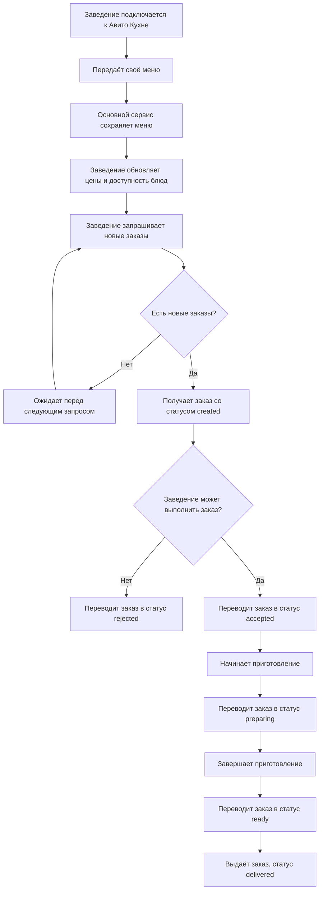

# CJM заведения

Диаграмма описывает путь заведения от публикации меню до завершения
обработки заказа.

## Какие могут быть проблемы

- сервис заведения временно не может обратиться к основному сервису;
- блюдо закончилось после последнего обновления меню;
- один заказ был получен заведением повторно;
- заведение пытается выполнить недопустимый переход статуса;
- пользователь отменил заказ раньше, чем заведение успело его принять.