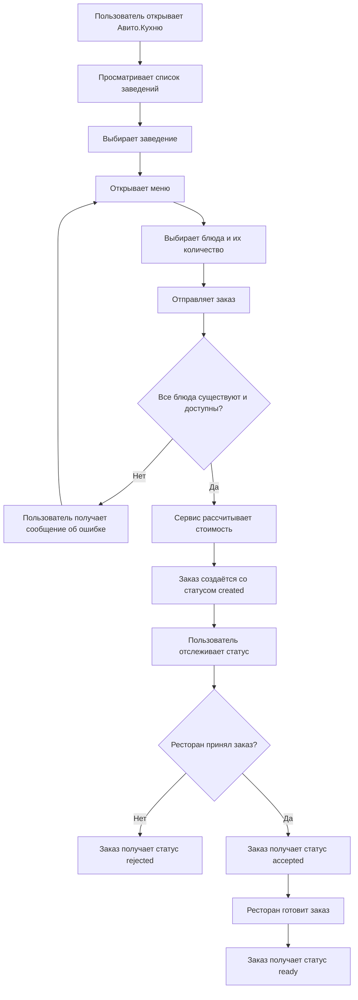

# CJM пользователя

Диаграмма описывает путь пользователя от выбора заведения до получения
результата заказа.

## Какие могут быть проблемы

- выбранное блюдо стало недоступно перед оформлением;
- ресторан отклонил заказ;
- пользователь повторно отправил запрос на создание заказа;
- цена блюда изменилась после создания заказа.