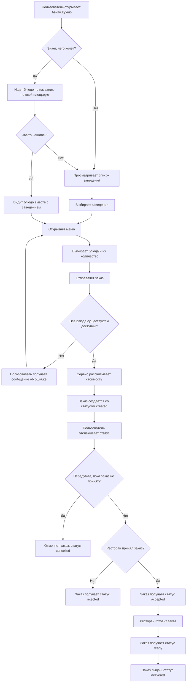

# CJM пользователя

Диаграмма описывает путь пользователя от поиска блюда до получения
результата заказа.

## Какие могут быть проблемы

- пользователь не знает, в каком заведении искать нужное блюдо;
- выбранное блюдо стало недоступно перед оформлением;
- пользователь передумал уже после того, как заведение приняло заказ;
- ресторан отклонил заказ;
- пользователь повторно отправил запрос на создание заказа;
- цена блюда изменилась после создания заказа.